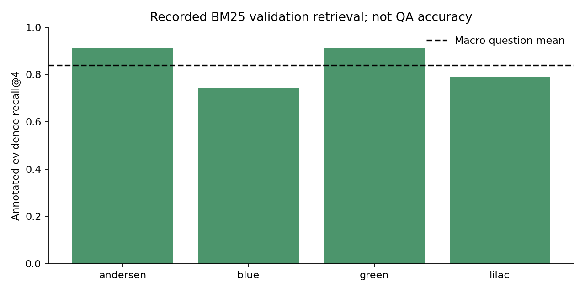

# Thematic Literature RAG

Retrieve evidence across public-domain books, follow character mentions through narrative position, and answer questions with source offsets. The pipeline combines BM25, dense retrieval and optional neural reranking. Exact citations can be checked after saving an answer. They establish where text came from, not whether an interpretation is correct.

Literary QA is still difficult here. The historical Persuasion reader scored 15.27% token F1; a Qwen experiment scored zero after its support gate. Cross-book theme diagnostics missed required evidence. A new T5 adaptation study uses real FairytaleQA annotations and source-family separation; full training is running and answer metrics are pending. The completed four-example CPU check verifies training and checkpoint replay only.

## Run

Use Python 3.11+ and a fresh environment for this repository. These research repositories share a `src` package and incompatible optional dependencies; a combined installation is unsupported.

```powershell
python -m venv .venv
.\.venv\Scripts\Activate.ps1
python -m pip install -e ".[dev]"
python -m src.cli fetch --acknowledge-local-rights
python -m src.cli index
python -m src.cli query "isolation rejection responsibility"
python -m src.cli synthesize "resentment revenge love" --books pride frankenstein
python -m src.cli arc Elizabeth pride --topic "vanity ignorance prejudice"
python -m pytest -q
```

On Linux/macOS activate with `source .venv/bin/activate`. Review [source rights](docs/data-card.md) before fetching. The default offline baseline uses TF-IDF and fitted truncated SVD, not a pretrained transformer. Optional `.[models]` installs real sentence embeddings, cross-encoder reranking and Docling; `.[reader]` installs pretrained QA readers. Neural model revisions are pinned. Docling HTML conversion was exercised; PDF OCR accuracy has not been measured.

```powershell
python -m pip install -e ".[models,reader,notebook]"
python -m src.cli index --backend sentence-transformer
python -m src.cli ingest my-book.pdf my-book
python -m src.cli answer "Who persuaded Anne to reject Wentworth?" persuasion
```

The selected `answer-v2` reader requires its matching source and chunk-contract index; [reader reproduction](docs/v2-improvements.md) gives the commands. `answer-v2 --output` saves an auditable envelope; `audit-answer` checks source, policy and offset consistency without model inference. It cannot authenticate an untrusted artifact or prove entailment.

## Notebooks and measured results

The [main notebook](notebooks/00_main_literature_rag.ipynb) contains readable preparation, retrieval, model, loss, training, evaluation and citation implementations. Its executed cells recompute real validation retrieval and audit an actual saved answer. Optional training, downloads and test scoring are disabled by default.

- [Source-family EDA](notebooks/01_source_family_eda.ipynb): executed split, length, annotation and ranking-group analysis.
- [Validation experiments](notebooks/02_validation_experiments.ipynb): actual historical comparisons, CPU replay receipt and validation evidence results. Full learning curves appear only when a completed run exists.
- [Citation and error analysis](notebooks/03_citation_and_error_analysis.ipynb): actual saved-artifact checks, rejected tampering and error counts.



BM25 recall@4 is 83.96% on 400 validation questions. This is annotated **section retrieval**, not answer accuracy. T5 training uses 3,314 QA from 74 stories; validation uses four held-out source origins. No test QA is mounted in the training job. See [Report](Report.md), [training protocol](docs/v5-training-protocol.json), [source-rights record](docs/v5-source-rights.json) and [actual CPU smoke receipt](docs/v5-cpu-smoke.json).

Historical answer scores use different books and are not direct improvements:

| Experiment | Test questions | Answer token F1 | EM |
|---|---:|---:|---:|
| MiniLM, Persuasion | 29 | 15.27% | 6.90% |
| Fine-context MiniLM, Journey | 27 | 8.33% | 3.70% |
| Frozen MiniLM, Cask | 28 | 19.84% | 14.29% |
| Qwen, Call of the Wild, support-gated | 30 | 0% | 0% |

These books are now observed historical tests. [Evaluation](docs/evaluation.md), [reader comparison](docs/v3-reader-experiment.md), [negative cached study](docs/v4-cached-reliability.md) and [generation failure](docs/generative-experiment.md) preserve policy selection, failed settings and exposure limits. The production reader remains MiniLM threshold 0/rank penalty 0.8. The larger reader and cached calibration changes did not justify promotion.

## Limits

Story identity is supplied in the new QA study; this does not evaluate global book identification. Human section boundaries and answerable-only annotations cannot establish unknown-question calibration. Source-family separation cannot rule out recurring plots or pretrained exposure. NarrativeQA answers were written from summaries and may not occur as literal book spans. Model margins are not calibrated probabilities.

Citations are Python character offsets in newline-normalized processed UTF-8 text. Docling offsets address converted text rather than PDF pages. Character attribution and thematic interpretation remain limited. Persistence uses checked JSON and numeric arrays, rejects old pickle indexes, and verifies source/model/chunk contracts. Data, raw QA, weights and credentials remain ignored; the software license does not relicense them.
